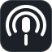

  

<h1 align="center">Castcorder</h1>

<b>Record your podcast with studio-quality tracks, wherever your guests are.</b> 
A free, open-source desktop app: talk over a live call while every machine records its own
microphone locally, then hands the files to you.

  
  
  
  
  

  <a href="#download">Download</a> |
  <a href="#how-it-works">How it works</a> |
  <a href="CHANGELOG.md">Changelog</a> |
  <a href="#get-help-and-give-feedback">Feedback</a> |
  <a href="CONTRIBUTING.md">Contributing</a>

______________________________________________________________________

## What is Castcorder?

Recording a podcast over a call usually means a compressed, glitchy recording of everyone's
voice. Castcorder fixes that at the source. On a call, each person's own computer records their
own microphone at full quality, straight to disk, and the files reach the host afterwards.
Internet hiccups during the call can make it sound rough live, but they never reach the
recording.

You run the app on the computer you record on, copy a room's link, and send it. Guests open the
link in Chrome, Edge or Firefox: no account, no install, no sign-up.

## Who is it for?

- **Podcast hosts and producers** who want clean separate tracks for editing, without paying for
  a hosted studio or trusting a cloud with their raw audio.
- **Guests** who just want to click a link and talk.
- **Small teams and friends** who record regularly, and want their contacts, rooms and
  recordings to stay on their own machines.

## What sets it apart

- **Local, uncompressed tracks.** Every participant's mic is recorded on their own machine as
  WAV (and FLAC), so the bad Wi-Fi of one guest does not damage anyone's track. Takes come with
  aligned copies and timing data for your editor.
- **Nothing is lost.** A guest who leaves, closes the tab, or loses the host keeps their
  recordings and delivers them later, even days later, the next time the host is reachable.
- **Yours, not a service's.** Free and open source, runs on your computer, files land in a plain
  folder. The live transcript is made on your machine with bundled models: no cloud, no
  downloads.
- **Works from anywhere.** Guests join over the internet; a relay carries calls that cannot
  connect directly. Rooms stay put: rejoin the same call and take numbers carry on.
- **A backup for the mic.** Record a second microphone beside the main one, and a microphone that
  drops out continues in a new segment.
- **Contacts and rooms.** Link your devices, add contacts with a link, see who is online, invite
  them to a call, and trust them in a room.

## Download

Installers for Windows, macOS and Linux are attached to each release on the
[**Releases page**](https://github.com/scnerd/castcorder/releases/latest):

| Platform | Installer                                        |
| -------- | ------------------------------------------------ |
| Windows  | `Castcorder_<version>_x64-setup.exe` (or `.msi`) |
| macOS    | `Castcorder_<version>_universal.dmg`             |
| Linux    | `Castcorder_<version>_amd64.AppImage` or `.deb`  |

The app checks for updates by itself and offers "Restart to update" (never during a call).

> The first release (v0.1.0) is not published yet; the badge and links above start working when
> it is. What it will contain is under [Unreleased](CHANGELOG.md).

## How it works

1. Open the app. It hosts your rooms quietly from the tray.
2. Copy a room's call link and send it to your guests (or invite a contact from the app).
3. Everyone talks. Press **Start take**: each machine records its own sources to disk.
4. Press **Stop take**. Guests' files are sent to you; each take lands in its own folder, with
   tracks aligned to each other.
5. Open the recordings folder from the tray, and drop the tracks into your editor.

More detail is in [docs/design.md](docs/design.md), and the words the project uses (room, call,
take, producer) are in [CONTEXT.md](CONTEXT.md).

## Get help and give feedback

- **Found a bug?** Use **Report a bug** in the app (the tray menu, or the home page) or
  [open a bug report](https://github.com/scnerd/castcorder/issues/new?template=bug_report.yml).
  It asks for your version and system.
- **Want something?** [Request a feature](https://github.com/scnerd/castcorder/issues/new?template=feature_request.yml).
- **What changed?** [CHANGELOG.md](CHANGELOG.md), and the notes on each
  [release](https://github.com/scnerd/castcorder/releases).

Both forms need a free GitHub account. Please do not paste call links or passwords: a call link
lets anyone who has it join your call.

## Contributing

Building from source, running the tests and the project's conventions are in
[CONTRIBUTING.md](CONTRIBUTING.md).

## Licence

MIT OR Apache-2.0 ([LICENSE-MIT](LICENSE-MIT), [LICENSE-APACHE](LICENSE-APACHE)) for everything
except `castcorder-rendezvous`, the introduction service, which is AGPL-3.0-or-later.
